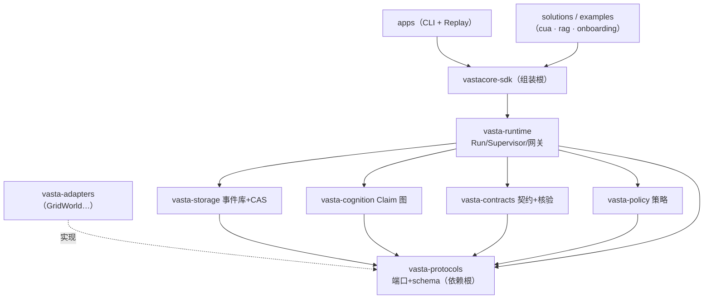

# VastaCore

> 面向长程、多模态、工具调用型 Agent 的**认知与执行可靠性平台**：
> 保留原始证据、管理可修订认知、约束并核验行动、按需构建可执行世界模型。

[](https://github.com/Marcher-lam/VASTA-CORE/actions/workflows/ci.yml)
[](LICENSE)


[快速开始](#快速开始) · [端到端原型](#端到端原型) · [文档目录](#文档目录) · [开发](#开发)

## 为什么需要它

长程、多模态、会调用工具的 Agent 有三种系统性失败，现有框架都没有正面解决：

| 失败模式 | 症状 | VastaCore 的回答 |
|---|---|---|
| **不可靠** | 幻觉动作、点错按钮、声称完成实则未做、状态误判 | 每个写动作走**六段链**：契约声明「什么算做对了」→ 独立核验器拿环境事实裁决，不信模型自评 |
| **不可审计** | 出事后说不清它当时看到什么、为什么这么做 | **无损证据库**：一切观察/模型交互/契约/核验先落内容寻址存储再被引用，事件溯源是唯一状态写路径 |
| **不可复现** | 同样的任务跑两次结果不同，无法离线调试与评测 | **确定性重放**：时钟/随机/环境读取一律注入，非模型路径字节级复现，模型响应整体落盘重放不重调 |

一句话论点：**Agent 的可靠性不该寄托在提示词上，该寄托在管道上。**
[examples/cua](examples/cua/README.md)（macOS 桌面 Computer-Use Agent）是这套论点的端到端实证。

## 设计思路

### 四根支柱

1. **无损证据（Evidence First，AD-2/3）**——领域状态只经追加事件变更，读侧全是投影；Artifact 先落盘、哈希校验后才允许被事件引用（sha256 分桶 CAS）。修正 = 新事件（`claim.refuted`），不是改旧记录。
2. **可修订认知（Revisable Cognition）**——环境规律以 Claim 图管理（working → hypothesis → guide 全生命周期），反例到达按依赖闭包**级联失效**：UI 改版、世界变迁不会留下默默过期的记忆。
3. **受约束行动（Governed Action，AD-4）**——状态改变型动作唯一通道：

   ```text
   契约 Contract → 策略 Policy →（审批 Approval）→ 工具网关 Gateway → 执行 Execute → 核验 Verify
   ```

   风险分级由工具清单强制（R0 只读 → R4 禁止），调用方自声明无效；核验失败走**有界恢复**（不盲目重试放大）；依赖不可用一律 **fail-closed**（AD-12）。R3 须人在环，批准必须对应真实挂起请求、不可伪造。
4. **可复现运行（Reproducible Run，AD-5）**——决策与数据路径禁用不可注入熵；重放/评测接确定性替身，接真实工具需显式授权。

### 架构分层（AD-1：依赖单向指向 protocols）



15 条架构决策（依赖根 / 事件溯源 / 租户作用域 / 幂等键 / 沙箱双轨时间…）见
[ARCHITECTURE-SPINE](docs/architecture/architecture-VastaCore-2026-09-08/ARCHITECTURE-SPINE.md)；
产品语义的完整定义见 [PRD](docs/prds/prd-VastaCore-2026-09-08/prd.md) 与 [Epic 全录](docs/epics.md)。

## 功能特性

- **接入五形态**（≤3 工程日）：SDK 三步起 ｜ HTTP 服务 ｜ 轨迹导入 ｜ Tool Proxy（既有工具零重写）｜ middleware/sidecar（任意语言伴生）
- **无损证据库**：SQLite 事件库 + sha256 CAS、多维检索、派生血缘、图像回看、自包含 HTML Replay、复现包离线重放
- **可信执行**：契约六段链、清单强制风险分类、策略四态 fail-closed、组合核验器（schema/read-back/不变量 DSL + 可注入）、有界恢复、R3 人工审批
- **认知资产**：Claim 图四类记忆全生命周期（冲突检测 / 级联失效 / 上下文预算内装配）、环境升级批量重验证与置信衰减
- **多 Agent 治理**：委派契约、角色边界、动态自治、组织风险预算、审批矩阵（guardrails 组合闸）
- **企业面**：RBAC/OIDC/SCIM、审计导出、驻留保留、BYOK/airgap、配额计费、发布金丝雀、SLO 演练
- **评测**：消融框架 + VastaLab 任务集 + 真实模型多种子置信区间（W-1 已解除）

## 快速开始

```bash
uv sync --all-packages                 # 必须带 --all-packages（工作区成员）
uv run python examples/quickstart.py   # GridWorld → SQLite 证据库 → L0 全量记录
uv run pytest -q                       # 1319+ 测试
```

详见 [docs/quickstart.md](docs/quickstart.md)（15 分钟首跑，含确定性重放的双根目录实验）。

### 把你的 Agent 接进来（SDK 三步）

```python
from vastacore import AgentSession

session = await AgentSession.create(
    env=my_env,        # ① 你的环境：实现 EnvironmentAdapter 五方法
    tools=[my_tool],   # ② 你的工具：ToolAdapter，清单强制风险分类
    contracts={"my_tool": {...}},   # ③ 契约模板：七必填段（risk 自动取清单分级）
    root=".vasta", seed=42,
)
async with session:
    await session.start()
    await session.reset()
    await session.act(Action(tool="my_tool", args={...}))
    # 六段链自动走：契约 → 策略 → 执行 → 核验 → 审计；无模板 fail-closed 拒执行
```

完整从零演练（自定义 env + 工具 + 模板 + 回放）：[examples/onboarding](examples/onboarding/README.md)；
接入摩擦点实测：[docs/onboarding-log.md](docs/onboarding-log.md)（端到端 1–3 小时）。

## 端到端原型（examples/，零侵入）

| 目录 | 一句话 |
|---|---|
| [examples/cua](examples/cua/README.md) | **macOS 桌面 CUA**（P0–P5 全 PASS）：SoM 视觉感知 + 点击反推标定 + AX 确定性核验 + 六段链执行 + R3 人在环 + 字节级回放 + Claim 图 UI-记忆（改版=反例级联失效）+ guardrails 四层闸 + 任务集 eval；附 23 条 macOS 桌面实测坑位表 |
| [examples/rag](examples/rag/README.md) | **多模态 RAG**：L1 向量粗筛 + L2 原始证据兜底两层检索、引用回源核验、消融量化（+13.1pp 关键词覆盖）；设计决策见 [DESIGN.md](examples/rag/DESIGN.md) |
| [examples/onboarding](examples/onboarding/README.md) | **从零接入演练**：自定义 env/工具/契约模板/回放五段单文件（≤3 工程日的最小路径） |

CUA 一行命令体验平台论点（「幻觉的 agent 被契约拦停」有事件流实证）：

```bash
uv run python -m examples.cua.run_task               # 六段链旗舰（42×3=126 全核验）
uv run python -m examples.cua.loop                   # VLM 自主闭环（vision/memory/auto）
uv run python -m examples.cua.textedit               # R3 人在环（原生 approval 事件）
uv run python -m examples.cua.replay --run-id <id>   # 确定性回放（逐字节一致）
uv run python -m examples.cua.run_memory             # cognition UI-记忆三相
uv run python -m examples.cua.eval                   # 任务集批量评测（guardrails 值守）
```

## 仓库结构

```text
packages/            # 十个 vasta-* 包（每包有 README：职责/API/依赖位置/测试锚点）
  vasta-protocols/   # 依赖根（AD-1）：事件信封 + 五协议端口 + 契约测试套件
  vasta-storage/     # Evidence Store：SQLite 事件库 + sha256 分桶 CAS + 血缘
  vasta-cognition/   # Claim 图与记忆（全生命周期 + 级联失效）
  vasta-contracts/   # ActionContract（六必填段）与组合核验器
  vasta-policy/      # 策略引擎四态 + fail-closed 回退
  vasta-runtime/     # RunEngine / Supervisor / ToolGateway / RunContext
  vasta-model-lab/   # 世界模型沙箱（受限子进程 → 容器/microVM 路线）
  vasta-eval/        # 消融、任务集、复现包、负载校准
  vastacore-sdk/     # 组装根（AD-1 唯一允许引用适配器的位置）
  vasta-adapters/    # 适配器实现（GridWorld 等；不被任何包 import）
examples/            # cua（桌面 CUA）· rag（多模态检索）· onboarding（从零接入）
docs/                # 文档地图见 docs/README.md
tests/               # 1319+ 测试（含 Hypothesis 性质测试与端口契约套件）
```

**依赖规则（AD-1）**：一切指向 `vasta-protocols`；核心包不反向依赖适配器（`uv run lint-imports` 强制）。

## 文档目录

按读者分层收录；**全量地图（含过程档案逐组索引）见 [docs/README.md](docs/README.md)**。

### 指南层（日常查阅）

| 文档 | 内容 |
|---|---|
| [docs/quickstart.md](docs/quickstart.md) | 15 分钟首跑：GridWorld → SQLite 证据库 → L0 全量记录 |
| [docs/onboarding-log.md](docs/onboarding-log.md) | 外部团队接入计时演练与已知摩擦点（SM-5 证据） |
| [CONTRIBUTING.md](CONTRIBUTING.md) | 贡献流程：环境 / 三道门禁 / 架构红线 / Story 簿记约定 |
| [SECURITY.md](SECURITY.md) | 安全策略：报告渠道与平台安全姿态 |

### 架构与产品层（系统定义）

| 文档 | 内容 |
|---|---|
| [ARCHITECTURE-SPINE](docs/architecture/architecture-VastaCore-2026-09-08/ARCHITECTURE-SPINE.md) | 15 条架构决策、三面运行拓扑、栈与结构种子 |
| [PRD](docs/prds/prd-VastaCore-2026-09-08/prd.md)（+[附录](docs/prds/prd-VastaCore-2026-09-08/addendum.md)） | 需求基线：82 FR / 15 NFR / 7 里程碑信号与验收标准 |
| [docs/epics.md](docs/epics.md) | Epic 1–12 全部故事与验收标准（FR/NFR 对照） |
| [plan.md](plan.md) | 完整产品蓝图（0–36 个月，PRD 上游） |
| [VASTA-BRAINSTORM.md](VASTA-BRAINSTORM.md) | 外部同类项目调研（蓝图输入） |
| [产品简报](docs/briefs/brief-VastaCore-2026-09-08/brief.md) | 产品定位一句话之源（+[附录](docs/briefs/brief-VastaCore-2026-09-08/addendum.md)） |

### 原型层（examples/，零侵入）

| 目录 | 内容 |
|---|---|
| [examples/cua/](examples/cua/README.md) | macOS 桌面 CUA（P0–P5 全 PASS，23 条实测坑位表） |
| [examples/rag/](examples/rag/README.md) | 多模态 RAG：两层检索 + 引用回源核验 + 消融（[设计决策](examples/rag/DESIGN.md)） |
| [examples/onboarding/](examples/onboarding/README.md) | 从零接入五段演练（自定义 env + 工具 + 契约模板 + 回放） |

### 治理与里程碑

| 文档 | 内容 |
|---|---|
| [docs/decision-log.md](docs/decision-log.md) | 跨切裁决记录（主仓 / W-1 / Apache-2.0 / 缺口清偿，只增不改） |
| [CHANGELOG.md](CHANGELOG.md) | 里程碑汇总（按 Story 提交，git log 即细目） |
| [LICENSE](LICENSE) | Apache-2.0（含显式专利授权） |

### 过程档案（只增不改，不逐条入目录）

Code review ×12、Story 记录 ×59、Epic 复盘 ×6、终检与对账 ×3、AC↔测试追溯矩阵——
统一在 [docs/README.md](docs/README.md) 的「过程档案」分组索引，此处不展开。

## 开发

```bash
uv run pytest -q                        # 测试（1319+）
uv run ruff check packages tests examples   # lint
uv run lint-imports                     # 架构依赖契约（AD-1 强制）
```

CI（GitHub Actions）：lint → import-linter → pytest（Python 3.12/3.13 矩阵）。
贡献流程与架构红线见 [CONTRIBUTING.md](CONTRIBUTING.md)；安全问题报告见 [SECURITY.md](SECURITY.md)。
过程档案（评审/复盘/对账）带日期存于 `docs/`，只增不改。

## 状态与路线图

**v0.1.0**：六阶段（Epic 1–12）全量交付——82 条 FR 全 delivered、NFR 工程可验面 15/15、属地运营三项登记在册（[终检增补](docs/project-final-review-addendum-2026-11-06.md)）。

已知边界（如实登记）：生产 SLO 月度统计 / 真跨机分布式部署 / 多区域演练待真实运营数据；OCR/ASR/支付为封闭域参考实现（注入面就绪）；PRD §12 开放问题已裁决四条（Apache-2.0 / 企业付费意愿所有者关闭 / 首批模型 DeepSeek / 公共插件市场暂缓——见 [决策日志](docs/decision-log.md)），余五条（GUI 场景、品牌核查、团队规模、SaaS 优先级、受众口径）仍处决策门。

## 许可证

**Apache-2.0**（含显式专利授权）——核心平台永久开源自托管；商业化走托管服务与企业支持（land-and-expand），不靠闭源切分（PRD §10 默认方案落地，开放问题 2 关闭）。
