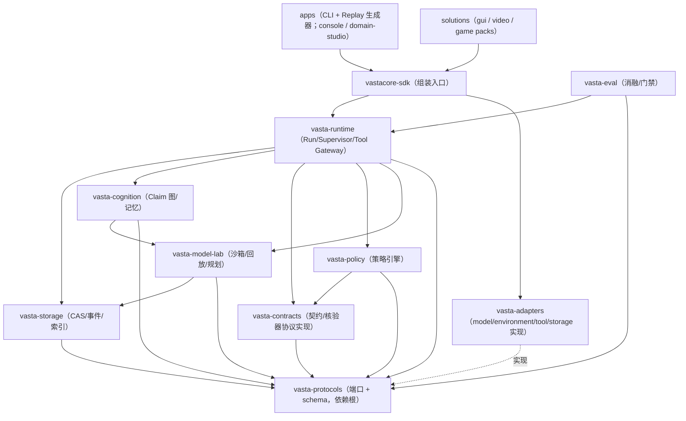
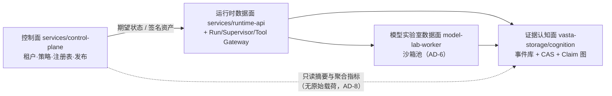

# Architecture Spine — VastaCore

## Design Paradigm

分层 + 端口/适配器（hexagonal）：`vasta-protocols` 定义全部端口（Model/Environment/Tool/Storage/Verifier 五协议 + 事件/契约 schema），核心包实现领域逻辑，适配器在外圈实现端口并注入。叠加一条硬规则：**事件溯源是唯一的状态写路径**（见 AD-2）——领域状态只经追加事件变更，读侧全部是投影。运行拓扑按蓝图分三面：运行时数据面、证据认知面、控制面（AD-8 划界）。

## Invariants & Rules

### AD-1 — 依赖方向：protocols 是依赖根

- **Binds:** all（E0–E13 全部包）
- **Prevents:** 包间任意 import、循环依赖、核心包反向依赖适配器实现
- **Rule:** 依赖只能指向 `vasta-protocols` 所在层：protocols 不依赖任何本项目包；核心包（storage/cognition/contracts/policy/runtime/model-lab/eval）只依赖 protocols 与更底层核心包；适配器只实现 protocols 接口；任何包不得 import 具体适配器，组装只发生在 `vastacore-sdk` 与 apps 入口。[ADOPTED]（蓝图 §16.4/§18.1 已定）



### AD-2 — 事件溯源是唯一状态写路径，持久化设施单点

- **Binds:** E1/E2/E3/E4/E6/E7（一切持久实体）
- **Prevents:** 双写路径、UPDATE/DELETE 事实、静默覆盖认知、各包自建私设存储（违反 INV-01/04）
- **Rule:** 一切状态变更以追加 `Event` 表达（Run 内单调序号 + 因果父项 + 类型），当前状态一律由投影从事件流重建；修正 = 新事件（claim.refuted、plan.invalidated），不是改旧记录。事件写入用 `(run_id, seq)` 唯一约束 + 乐观并发，冲突即拒绝重试，不覆盖。一切持久化（事件库/CAS/索引）只能经 `vasta-storage` 的设施，其他包不得自建持久化存储。[ADOPTED]

### AD-3 — Artifact 先落盘后引用，blob 布局单点定义

- **Binds:** E1（Evidence Store）、所有产生载荷的单元
- **Prevents:** 悬空引用（事件指向未持久化载荷）、各单元自造 blob 目录布局
- **Rule:** Artifact 持久写入且哈希校验完成后，才允许产生引用它的事件（元数据事务与载荷写入失败不得产生"已捕获"事件）；原始载荷只能经 `vasta-storage` 的内容寻址 sharded 布局（sha256 前缀分桶）写入，任何其他包不得直接写 blob 存储。

### AD-4 — 写动作唯一通道，分类由网关强制

- **Binds:** E3/E4（Runtime、Tool Gateway）、SDK 与一切调用方
- **Prevents:** 旁路执行破坏审计链（NFR-001 六段链断裂）、自声明"只读"的工具被当真
- **Rule:** 状态改变型动作只能经 `Contract → Policy →（Approval）→ Tool Gateway → Execute → Verify` 管道执行；模型适配器与业务代码不得直接调用业务工具；Tool Gateway 是唯一持有业务工具凭证的组件。读写/风险分类以工具清单为据、由 Tool Gateway 强制判定，调用方自声明无效；不存在"合法只读旁路"——沙箱与世界模型对环境的一切访问同样经适配器接口并按分类执行（含 R0 自动执行并记录）。[ADOPTED]（INV-05、FR-030）

### AD-5 — 确定性重放：非模型路径禁用不可注入熵

- **Binds:** E3/E4/E5/E6（运行循环、核验器、模型实验室、评测）
- **Prevents:** 各单元各自引入墙钟/随机/环境读取导致历史不可离线重放（NFR-002、AC-08 失效）
- **Rule:** 决策与数据路径不得直接使用系统时间、随机数、环境变量读取或全局可变单例——一律经 `RunContext` 注入（时钟、种子、配置快照）。**例外（见 AD-16）：安全强制机制使用真实时钟**。模型调用的请求与响应整体作为 Artifact 落盘，重放时不重新调用模型、不重新执行生成代码（读记录）。重放/评测模式下适配器必须接确定性替身，接真实工具需显式授权。

### AD-6 — 生成代码只在沙箱运行，激活必须带验证轨迹

- **Binds:** E5（World Model Lab）
- **Prevents:** 生成代码越权（网络/凭证/宿主文件）、无验证痕迹的模型被激活
- **Rule:** WorldModel 生成的代码只能进受限沙箱：默认无网络、无业务凭证、无宿主目录，CPU/内存/进程/时间硬限制，模块与系统调用 allowlist。MVP 用受限子进程（明示非生产边界），Stage 3 起生产用 rootless 容器（Podman 类）或 microVM（Firecracker/Kata 类）独立池。模型从 candidate 到 active 必须携带验证轨迹（静态检查 + 声明范围历史回放通过 + 元决策 Event 留痕），无轨迹不得激活。[ADOPTED]（INV-11、FR-044/046、蓝图 §13.9）

### AD-7 — 租户作用域前置

- **Binds:** 一切持久实体与索引（E1/E2/E6/E7/E9）
- **Prevents:** Stage 3 多租户化时全存储层/索引返工
- **Rule:** 每个持久实体自带 `tenant_id` + `project_id` 作用域键（本地单租户也保留，取默认值）；一切存储查询与派生索引必须经作用域过滤，禁止无作用域的全表访问路径；跨租户数据流动只允许经显式发布流程（蓝图 §11.5）。CAS 字节层的全局去重与租户可达性分离，见 AD-17。

### AD-8 — 控制面不接触原始载荷

- **Binds:** E9/E10（control-plane 及一切控制面服务）
- **Prevents:** Hybrid 部署（SaaS 控制面 + 客户私有数据面）时数据流与合规返工
- **Rule:** 控制面组件（租户/策略/注册表/发布/配额）只接收元数据、签名摘要与去标识聚合指标，任何原始 Artifact 载荷与原始证据内容不得进入控制面存储或日志。[ADOPTED]（蓝图 §16.2）

### AD-9 — Schema 版本纪律

- **Binds:** E0（协议）、一切对外 schema（事件/API/插件/清单）
- **Prevents:** 破坏性变更令历史事件不可读、插件生态碎片化
- **Rule:** 所有对外 schema 携带 semver；minor 只增可选字段；破坏性变更进新主版本并保 N-1 客户端兼容窗口；历史事件永不重写，投影升级用迁移器；弃用走四阶段（告警→迁移→只读→移除）。[ADOPTED]（蓝图 §17.4、NFR-007）

### AD-10 — 异步边界统一

- **Binds:** E3 及一切服务/worker（apps 与 CLI 入口除外）
- **Prevents:** 半同步半异步混杂导致事件循环阻塞与死锁
- **Rule:** 核心服务与适配器接口 async-first（asyncio）；只有同步 SDK（如本地驱动、沙箱子进程管理）允许存在于 adapter 边缘并经**定容**线程/进程池隔离（池上限入配置，防止无界线程泄漏）；事件循环内禁止阻塞 IO、sleep 与长 CPU 任务（后者进 worker 池）。

### AD-11 — 幂等与至少一次

- **Binds:** E1/E4/E6（执行、派生 worker、评测、发布）
- **Prevents:** 重复副作用、事件重放产生重复派生、投影不可恢复
- **Rule:** 幂等键由 Tool Gateway 用唯一确定函数派生：`(run_id, plan_step_id, tool, canonical_args_hash)`；同键重复请求**只允许一种行为**——返回原执行结果并附 `replayed=true` 标记，绝不静默重执行（键派生函数与规范化工具入 protocols，禁止各单元自定）。评测/重放走确定性替身（AD-5），因此消融测到的是行为而非网关缓存。异步派生至少一次投递 + worker 幂等（同内容哈希先查后算）；事件消费者保存 checkpoint，任意投影可从事件历史重建。[ADOPTED]（蓝图 §17.3）

### AD-12 — 依赖不可用时 fail-closed

- **Binds:** E3/E4/E9（Runtime、Tool Gateway、控制面）
- **Prevents:** fail-open 行为摧毁审计链与安全边界（两单元对"依赖挂了怎么办"做出相反选择）
- **Rule:** Policy/Approval 不可用 → 高风险（R2+）动作一律拒绝（fail closed），低风险只读可放行并降级记录；Evidence Store 不可用 → 禁止执行新的写动作（已有 Run 转暂停），只读观察按策略放行；派生服务不可用 → 原始证据照常入库，派生延后；沙箱不可用 → 绕过世界模型直接推理或暂停，不放宽安全。降级事件本身落 Event。[ADOPTED]（蓝图 §21.2）

### AD-13 — WorldModel 状态流的唯一桥接点

- **Binds:** E2（cognition）/E5（model-lab）
- **Prevents:** claim.\* 与 world_model.\* 两族事件各建"当前状态"、反例到达时无人桥接（AC-04 系统级失效）
- **Rule:**（评审修复补记：AD-13 产生 cognition → model-lab 的单向依赖边，已补入 AD-1 图。）WorldModel 的状态以 `world_model.*` 事件族为唯一事实源（Claim 九类走 `claim.*`，互不代管）；但失效传播由 `vasta-cognition` 单向桥接且它是唯一 owner：使 WorldModel 失效的反例经 `claim.refuted` 后，cognition 必须发出对应 `world_model.suspended/scope_narrowed`，model-lab 不得自行监听反例再各写一套。下游读"当前活跃模型"只能读 cognition 的投影。

### AD-14 — CAS 租户语义：字节全局去重，可达性租户私有

- **Binds:** E1/E2（storage、派生索引、删除）
- **Prevents:** 同哈希去重撞上租户过滤——要么漏检要么跨租户泄漏（NFR-003）；删除证明与共享字节存活矛盾（FR-017）
- **Rule:** blob 按 sha256 全局单份存储，但一切查询/派生/权限只经**每租户的引用映射表**（tenant_id, artifact_hash），无映射即不可达；删除 = 删映射 + 引用计数归零后清字节，删除证明记录映射删除（不承诺字节即时消失）；字节物理共享不构成跨租户可访问性。

### AD-15 — 沙箱时间双轨：安全墙钟，行为注入

- **Binds:** E5（model-lab/沙箱执行器）
- **Prevents:** "注入时钟让超时永不复现"与"真实墙钟违反确定性"的两难（两团队各有文本依据地互相指责）
- **Rule:** 安全强制（执行超时、资源上限、预算熔断）使用**真实墙钟**，其触发作为 `system.timeout / system.limit` Event 记录——重放读该记录，不重新计时；沙箱内生成代码与规划逻辑感知的时间一律注入（AD-5）。超时事件是既成事实，重放不得推翻。

## Consistency Conventions

| Concern | Convention |
| --- | --- |
| 命名 | 包 `vasta-*`；事件 past-tense 点分（`run.created`、`claim.refuted`）；实体类 PascalCase；FR/NFR/INV/AC 编号沿用 PRD，不得重编 |
| 事件族封闭集 | 13 族封闭：run/observation/artifact/claim/memory/plan/action/verification/world_model/evaluation/release/incident/episode；新增族 = protocols minor 版 + E0 变更评审，禁止自造同义族（episode = Run 内可重置局段，incident = 事故） |
| ID 与格式 | 实体 ID 用 UUIDv7/ULID 字符串（Python 基线经 `uuid6` 库，3.14+ 可换 stdlib）；Artifact 一律 sha256；时间 ISO8601 UTC；金额/数量用整数分位或 Decimal，禁止浮点 |
| 错误形状 | 统一信封 `{code, message, retryable, run_id, event_id}`；Verification 四态 `pass/deviation/inconclusive/system_error` 为固定枚举 |
| 遥测与日志 | OTel `trace_id` 贯穿 Event 与日志；结构化日志；日志与遥测不记模型密钥、不记原始载荷内容（AD-8 同约束） |
| 配置 | pydantic-settings + 环境变量；配置对象不可变；禁止全局可变单例（与 AD-5 一致） |
| 测试 | `vasta-protocols` 提供每类端口的契约测试套件；每个适配器/插件必须通过对应套件才能合入；关键路径 pytest + Hypothesis 性质测试 |

## Stack

SEED — 2026-09-08 经 PyPI/官方源逐项核证；代码存在后由代码所有。

| Name | Version |
| --- | --- |
| Python | 3.12+（PRD 基线；开发环境 3.13） |
| uv workspaces | 最新稳定（monorepo 工具链） |
| pydantic | 2.13.x |
| fastapi | 0.141.x |
| typer | 0.27.x |
| uuid6 | 最新稳定（UUIDv7；Python <3.14） |
| pytest | 9.1.x |
| hypothesis | 6.167.x |
| SQLite（stdlib，本地档） | 随 Python ≥3.12 |
| PostgreSQL（Team 档，Stage 3+） | 17+ |
| S3 兼容对象存储（Team 档，Stage 3+） | 任意 S3 兼容 |
| opentelemetry-sdk | 1.44.x |
| playwright（Stage 2，GUI Pack） | 最新稳定 |

## Structural Seed

```text
VastaCore/
  packages/
    vasta-protocols/   # 端口 + 全部 schema（事件/契约/清单），依赖根，零本仓库依赖
    vasta-storage/     # CAS、事件库、派生索引、生命周期（AD-2/3/7/11/14）
    vasta-cognition/   # Claim 图、记忆、冲突、晋升、WorldModel 桥接（AD-2/7/13）
    vasta-contracts/   # 契约模板、核验器协议实现（AD-4）
    vasta-policy/      # 策略引擎、风险分级、自治等级（AD-4/12）
    vasta-runtime/     # Run 循环、Supervisor、Tool Gateway、RunContext（AD-4/5/10/11/12）
    vasta-model-lab/   # 沙箱、回放、性质测试、规划（AD-5/6/15）
    vasta-eval/        # 消融、门禁、复现包、负载校准（AD-5/11）
    vastacore-sdk/     # 组装入口 + 便捷 API（唯一知道适配器的地方，AD-1）
    vasta-adapters/    # model/environment/tool/storage 适配器实现（AD-1）
  services/            # Stage 3+：control-plane / runtime-api / artifact-worker / model-lab-worker / audit-exporter
  apps/                # MVP 起：vasta CLI + 自包含 HTML Replay 生成器；Stage 2+：console / domain-studio
  solutions/           # 垂直包：vastalab / gui / video / game
  schemas/             # JSON Schema 导出与 N-1 兼容金件（AD-9）
  plugins/  examples/  tests/  docs/  deploy/
```

运行拓扑（控制面划界见 AD-8）：



## Capability → Architecture Map

| Capability / Area（PRD §4） | Lives in | Governed by |
| --- | --- | --- |
| 4.1 接入与运行时 | vasta-runtime、vasta-adapters、vastacore-sdk | AD-1/4/5/10/11/12 |
| 4.2 无损证据平台 | vasta-storage（+services/artifact-worker） | AD-2/3/7/11/14 |
| 4.3 认知资产与记忆 | vasta-cognition | AD-2/7/9/13 |
| 4.4 可信执行 | vasta-contracts、vasta-policy、runtime/Tool Gateway | AD-4/11/12 |
| 4.5 世界模型与规划 | vasta-model-lab（+services/model-lab-worker） | AD-4/5/6/15 |
| 4.6 多 Agent 与人机 | vasta-runtime（Supervisor/委派） | AD-4/11 |
| 4.7 回放、评测与发布 | vasta-eval、apps（CLI + Replay 生成器） | AD-2/5/9/11 |
| 4.8 企业控制面 | services/control-plane | AD-7/8/9/12 |
| 4.9 扩展生态 | plugins + vasta-protocols + schemas/ | AD-1/9 |

## Deferred

- **SLO / 容量 / 灾备数字基线**（PRD §10 显式委托架构承接）——数字由 `vasta-eval` 负载测试校准后钉入 services 运行手册，蓝图 §21/§20.2 为初始目标；本脊柱已锁行为语义（AD-12 fail-closed、AD-11 可恢复、AD-15 超时事实化），不锁毫秒数。
- **消息队列 / 独立向量库 / K8s / OPA / SSO 选型**——吞吐与检索瓶颈证明前用成熟托管件（蓝图 §19.3 证据条件）。
- **Air-gapped 形态细节**（离线镜像、本地模型、离线许可，FR-074/NFR-008）——语义已由 AD-8/AD-9 保证可迁移，实现随 Enterprise 阶段决策。
- **多节点部署与跨进程恢复细节**（FR-007）——单机 MVP 先行，事件语义已由 AD-2/11 保证可迁移。
- **规划算法实现**（BFS/A*/MCTS/约束求解）——接口由 protocols 固定，算法是插件内部自由度。
- **Console/Domain Studio UI 框架与信息架构**——Stage 2+，随 UX 工作决定。
- **计费计量、边缘形态、跨区域数据面**——商业与部署证据不足前不决策。
- **规则 DSL 具体语法**——边界待 PRD 开放问题 7（Team Beta 前）确认；接口已由蓝图 §13.3 最小接口约束。
- **沙箱生产化选型（rootless 容器 vs microVM）**——MVP 受限子进程（AD-6 已定边界与升级时点）。
